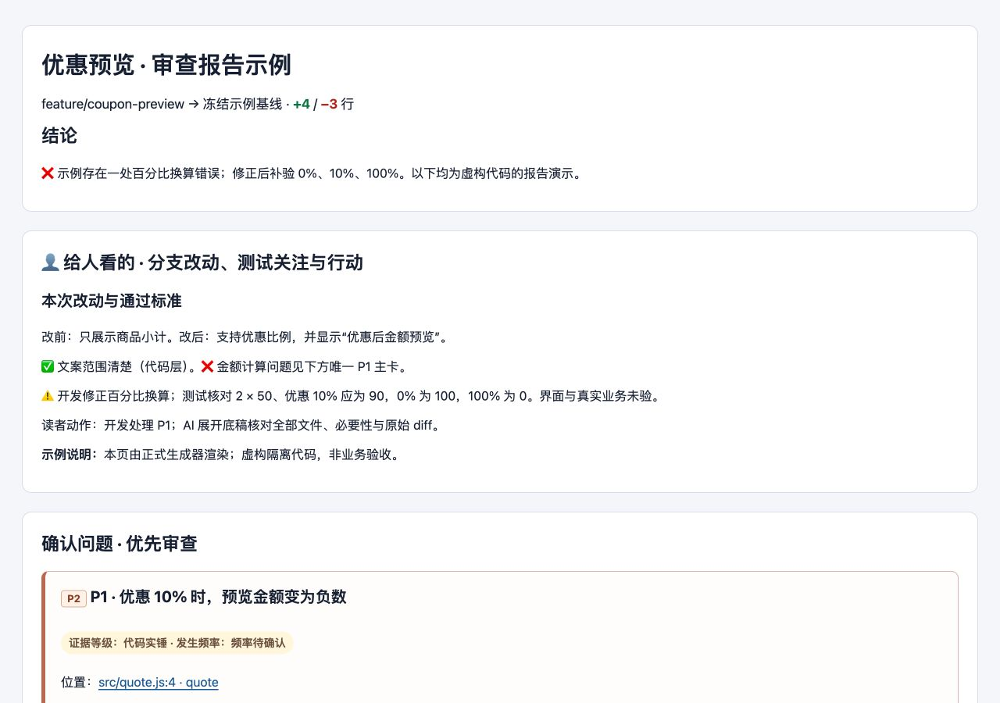
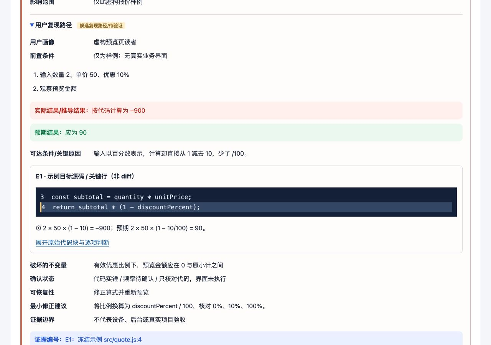
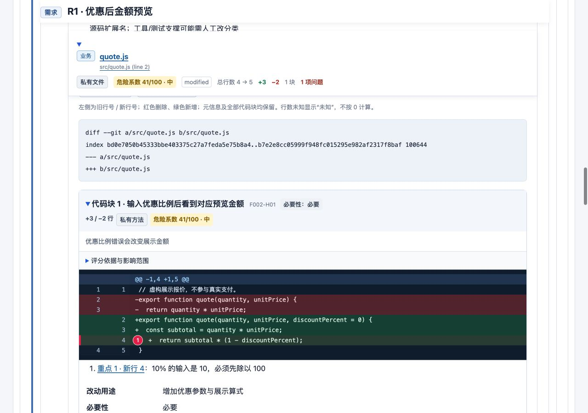

# 审查报告 · Review Report

把分支改动整理成能做决定的离线 H5：先说明改了什么、改前改后、测试关注与下一步，再给关键原因旁的源码证据。**人看决策，AI 查全量**：所有非测试文件和每个代码块先完成实质审查，完整判断与原始 diff 默认折叠，供 AI 二次复核或人工抽查。

适合需要理解整分支的研发、评审者，以及按场景验收的产品和测试。支持当前工作区、暂存区、指定文件或 commit range。关键词“审查报告”可自动选用，也可显式调用 `$review-report`；生成报告本身不修改业务代码或执行提交、发布、外部发送。

**每次调用固定版本，后台自动更新。** 安装的是带运行时的稳定包；本次任务绑定同一份正文与资源快照，后台只检查当前 Skill，校验完成后由后续调用切换。无需常驻服务、定时任务或宿主全局配置。

## 安装与最短使用

需要 **Node.js ≥22.20、Git、Python ≥3.10**。生成器仅用 Python 标准库，无需 `pip install`。在要审查的工程根目录运行：

```sh
npx skills@1.8.1 add https://github.com/seedleap/loopit-skills/tree/skill-releases \
  --skill review-report -a codex -y
```

添加 `-g` 可安装为用户级。已有同名安装先检查并保护本地修改，尤其此前从 `main` 安装的静态版本。安装工具的覆盖确认不代表可以丢弃本地编辑。

然后在 Codex 直接说：

```text
$review-report 为当前工作区生成审查报告，输出到仓外目录。
说明整体改动、改前改后、测试关注和通过标准；人先看结论与动作，AI 保留全量底稿。
```

审查整个分支时明确真实基线，例如：

```text
请生成当前分支相对 origin/main 的审查报告。
保留每个冻结提交的代码演变，问题只维护一张主卡，关键源码证据就近展示。
```

`origin/main` 应替换为工程实际目标。Skill 会核对 checkout、分支、HEAD 和 dirty；未读取远端时只称本地基线，不把缓存 ref 叫作最新远端。

## 报告怎么看

先看业务主线、改前改后和测试标准；✅、❌、⚠️ 绑定具体对象、版本、证据层级和读者动作。确认问题保留唯一主卡，高关注但通过的启动、公共埋点、测量、映射和大块公共改动也解释影响边界。



*正式生成器渲染的虚构报价示例，非业务验收。前层回答“发生什么、怎么验、谁做下一步”。*

关键原因旁直接给最小源码、真实行号与解释。源码高亮标为“非 diff”，完整 patch 另保留。可选 `issue.inline_evidence_html` 只接受安全静态内容与内嵌 PNG/JPEG，滤除外链图片、SVG、脚本、事件属性及越出父层的片段；旧输入与旧 `issue_evidence_html` 继续兼容。



*唯一问题主卡中，算式、原因、证据等级与代码跳转保持在一起。P1 是问题编号，旁边的 P2 是影响优先级。*

完整层按 **需求/修复关系 → 冻结阶段 → 文件 → hunk** 展开。每个非测试文件和 hunk 都核对必要性、合理性、原行为、消费者、反事实与风险；标题显示作用域、危险系数和实际增删行数。评分仅安排审查顺序，不代表故障概率或放行。测试默认只独立统计增删行数，标“跳过审查”；行数不等于测试通过。



*桌面真实浏览器截图。关系与文件标题在所属范围吸顶、按真实高度避让；跨折叠证据链接会打开所需祖先。390px 已检查页面无横向溢出；深层代码区较窄，完整逐项复核建议使用桌面。*

## 更新与状态

稳定包由现有 `main → CI → skill-releases` 链路生成，包含 `SKILL.md` 引导器、`workflow.md` 正文、`scripts/entry.mjs`、运行时与全部资源。从 `main` 复制正文不具备逐调用更新接线。

1. 每次选用都重新执行安装目录的 `scripts/entry.mjs`，包括自动选用、同会话再次使用及压缩后继续。
2. 读取回执的 `version`、`workflowPath`、`resourcesRoot`；本次所有脚本与参考都从这份资源根目录解析。
3. 入口启动一次性静默后台检查，只检查 `review-report`。当前任务不等网络、不切版本。
4. 新版校验和准备完成后，下次调用才使用新版。后台未完成、离线、限流、损坏包或本地修改均保留已有可用版本；项目级和用户级安装按实际安装目录隔离。

在安装时所在的工程查看：

```sh
node .agents/skills/review-report/scripts/entry.mjs --status
```

用户级或自定义目录需换成真实安装目录。回执包含当前 `version`、固定正文/资源路径、`modified`、`pendingVersion` 与 `lastCheck`。`lastCheck.result` 的 `current` 表示检查时已是当前稳定版，`updated` 表示新版已准备完成，`checking` 表示后台未完成，`failed` 搭配 `code` 查看原因。`LOCAL_MODIFIED` 时先保护本地编辑，不能靠强制覆盖解决。

更新依赖宿主真正执行每次入口及已有权限；`SessionStart` 不能替代逐次执行。宿主未执行入口或不允许后台进程时，保留能力限制，不宣称更新已发生。

## 输出与边界

- 输出为可离线打开的单文件 `report.html`，另保留冻结 `snapshot.json` 与人工判断 `review.json`；多提交用 manifest 冻结阶段。默认写仓外。
- 包内包含 [file-change-review 方法](skills/review-report/references/file-change-review.md)、[plain-language 方法与模板](skills/review-report/references/plain-language.md)及[字段语义核验](skills/review-report/references/field-semantics-evidence.md)，无需另装强制依赖。
- [21 条可分享案例](skills/review-report/memory.md)提供反例与核验动作，不包含原项目代码、个人档案或私聊，不能作为当前业务事实。
- 修复回填保留原问题与双基线：“修复前 → 修复后”和“冻结目标 → 修复后”，不让源码高亮代替真实增删。
- 人审、代码/测试、PR/CI、构建、设备/后台、报告回填、外部同步分别记账。设备、模拟器和飞书操作依使用者当次指令及项目合同；本包不携带个人永久授权，不提供飞书工具。
- 生成器只校验结构、覆盖、指纹、行号与评分算术。审查语义须沿真实生产者、消费者与目标依据核实，绿色测试不能代替逐项判断。

手动使用脚本时，先执行入口并使用回执的 `resourcesRoot`。参数与输入字段见[数据合同](skills/review-report/references/report-data.md)，完整核对项见[验收清单](skills/review-report/references/acceptance.md)。

## 打开与复现安全示例

克隆本仓库后，直接打开[已生成示例 HTML](examples/coupon-preview/report.html)。GitHub 源码视图显示 HTML 文本，需下载后在浏览器打开。[冻结快照](examples/coupon-preview/snapshot.json)与[人工判断](examples/coupon-preview/review.json)均为虚构代码。

在本仓库根目录生成到新的仓外目录：

```sh
python3 code-review-skills/examples/generate.py --output-dir /tmp/review-report-demo
```

同名文件已存在时停止，换新目录即可。脚本建立一次性 Git 样例、采集真实 patch，再用正式生成器渲染；导出副本将仓库位置改为明确的 `/example/quote-demo`，不携带本机临时路径。`--skill-root` 可指向入口回执的资源根目录，以验证安装包。

三张图片均为该 H5 的真实浏览器截图，没有使用原业务截图或手绘替代。维护示例后应重生成、核对桌面与窄屏并重拍；个人来源指纹与验证回执不入公开仓库。

## 开发验证

```sh
npm ci --ignore-scripts
npm run validate
python3 code-review-skills/tests/validate_structure.py
python3 -B code-review-skills/skills/review-report/scripts/test_report.py
python3 -B code-review-skills/skills/review-report/scripts/test_compact_report.py
npm test
```

Python 两套回归覆盖冻结范围、完整 patch/行号、旧输入、关系、评分、片段安全与折叠结构；Node 测试复用现有更新边界，并以真实包验证快照、后续切换、包内资源和报告生成。CI 同步执行。结果只覆盖各自合同，示例及这些测试不证明使用者的业务审查、设备或后台收件。
